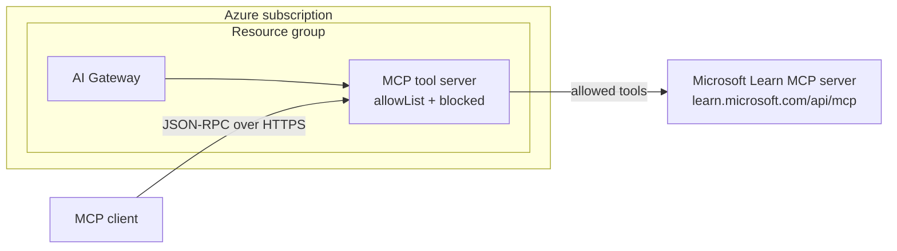

# Azure AI Gateway MCP demo

- Created and maintained by **[Katie Kodes](https://katiekodes.com/)**, 8/17/2026.
- Accompanying blog post: [How to censor MCP servers with Azure APIM](https://katiekodes.com/censor-mcp-with-apim/).

Previously based on [Azure Blog author Sam Cogan's demo](https://techcommunity.microsoft.com/blog/appsonazureblog/controlling-tool-access-with-apim-mcp-gateway/4529225), but then Microsoft discontinued that Azure APIM feature and I had to refactor it for the new Azure AI Gateway resource type.

This demo puts the public [Microsoft Learn MCP server](https://learn.microsoft.com/api/mcp) behind the dedicated Azure AI Gateway resource. Only `microsoft_docs_search` and `microsoft_docs_fetch` are exposed; `microsoft_code_sample_search` is blocked.

## Why

MCP servers can combine sensitive data access, untrusted content, and external communication. This demo shows how to narrow the tools clients can discover and invoke at a centrally managed gateway instead of relying on each client's configuration.

## How it works

Terraform creates a `Microsoft.ApiManagement/aigateways` resource and an MCP tool server in its default workspace. The tool server uses AI Gateway's native `allowList` and `blocked` settings.  _(Rather than Sam Cogan's old APIM service API & XML policy approach.)_  The backend is the existing Microsoft Learn MCP endpoint; no "model" deployment is created for this gateway.

The gateway is created in East US 2, one of the preview regions. Terraform exposes the runtime URL returned by the tool-server resource as `mcp_server_gateway_url`; use that output when configuring a client.

The end-to-end smoke tests verify that the two allowed tools remain callable and that the blocked tool is not exposed and cannot be invoked through the gateway.

## Repository layout

- [`.prereqs/AA-tf/`](.prereqs/AA-tf/) provisions the resource group, AI Gateway, and MCP tool server through Terraform and AzAPI. The gateway and tool server use the `2025-09-01-preview` ARM API, because it's proven the least finicky.
- [`.prereqs/BB-test-if-AA-tf-actually-gatekeeps/`](.prereqs/BB-test-if-AA-tf-actually-gatekeeps/) contains a Node/TypeScript/Vitest smoke test using the official [`@modelcontextprotocol/sdk`](https://www.npmjs.com/package/@modelcontextprotocol/sdk). It calls Microsoft Learn directly as a baseline, then through the gateway.

## Prerequisites

- PowerShell 7, Terraform, Azure CLI, Node.js, and npm.
- An Azure subscription and Entra tenant where you can create resources.
- The `Microsoft.ApiManagement` resource provider registered in the subscription.
- Azure CLI sign-in as a principal with permission to create the resource group and AI Gateway.
- For the smoke test, Entra delegated consent for the `https://azure-api.net/aigateway/Data.All` scope.
- During preview, AI Gateway is available in East US 2 and Sweden Central. This configuration uses East US 2.

## Usage

1. Set these user-scoped environment variables: `DEMOS_my_entra_tenant_id`, `DEMOS_my_azure_subscription_id`, and `DEMOS_my_workload_nickname`.
2. From `.prereqs/AA-tf/`, run `zzz-run-something-like-this-to-plan.ps1` to preview, then `zzz-run-something-like-this-to-apply.ps1` to create the resources.
3. From `.prereqs/BB-test-if-AA-tf-actually-gatekeeps/`, install dependencies with `npm ci`, then run `zzz-run-something-like-this-to-test.ps1`. The script reads the MCP runtime URL from Terraform output and obtains an Entra token with the `https://azure-api.net/aigateway/Data.All` scope through Azure CLI. If consent is missing, sign in with `az login --scope https://azure-api.net/aigateway/Data.All` and rerun the test.
4. When finished, run `zzz-run-something-like-this-to-destroy.ps1` from `.prereqs/AA-tf/`.

## Disclaimer

This is a demo, not a production-ready reference architecture. AI Gateway is in preview; confirm supported behavior and regions before using it for production workloads.